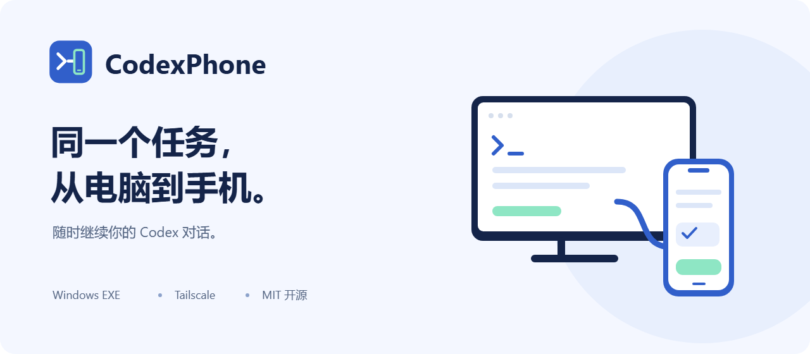
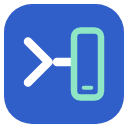
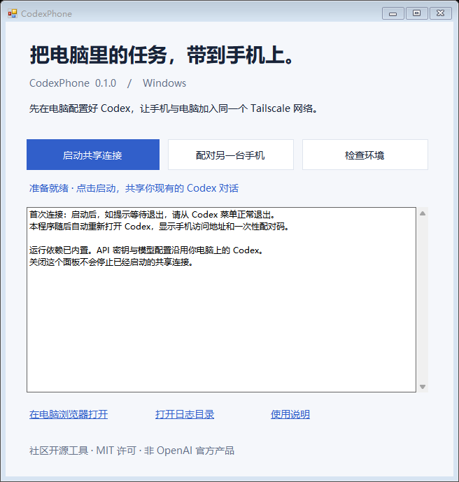
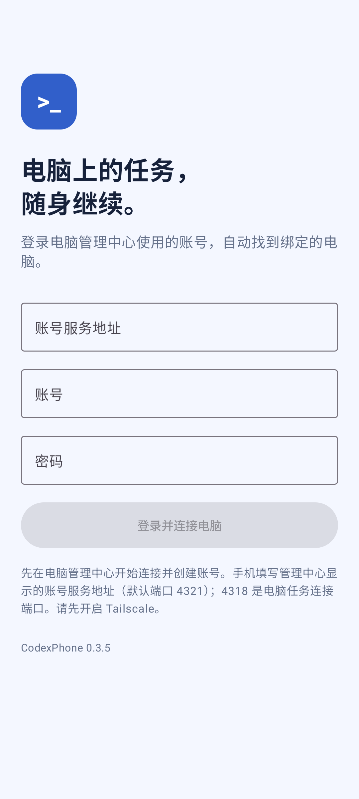

<p align="center"></p>

# CodexPhone

在手机上继续电脑里的 Codex 对话。通过自己的 Tailscale 网络连接，使用电脑上原有的 Codex 和 API 配置。

**Android 8.0+ · Windows x64 · MIT 开源 · 社区项目，非 OpenAI 官方产品**



## 下载与开始

从本仓库的 **Releases** 下载 `CodexPhone-版本-win-x64.exe`。双击打开，启用共享连接，在“账号与电脑”创建账号并绑定本机。手机填写账号服务的 Tailscale 地址（端口 4321），登录同一账号即可连接，无需配对码。

EXE 内置 Node.js 和原生适配器，不需要安装 pnpm 或编译器。它在当前用户目录释放运行文件，不修改 Codex 安装包或系统环境变量，不需要管理员权限。

你需要先准备：

- Windows 11 x64，并已安装、配置好可正常发消息的 Codex 桌面应用。
- 电脑和手机加入同一个 Tailscale 网络；无需开启 Serve 或 Funnel。
- 首次切换时，从 Codex 菜单正常退出一次，让启动器自动重新打开它。

程序等待后端稳定至少 15 秒才完成连接。以后通过 CodexPhone 启动，共享现有对话。账号、授权和项目保存在用户目录，升级保留。

已有源码版或旧版正在共享时，新版核对进程归属后直接复用，避免打断任务。面板的“桌面快捷方式”会保存一份稳定的启动程序并创建桌面入口，下载文件移走后仍可使用。图标与横幅的 SVG 源文件位于 assets/brand。

详细步骤见 [使用说明](docs/USER_GUIDE.md)，版本变化见 [Release Notes](docs/RELEASE_NOTES.md)。

## 功能

- 浏览、搜索、继续电脑上的对话，共享任务事件、审批与中断。
- 手机管理项目目录、新建任务、标记重点对话。
- Enter 换行，点击箭头发送；失败保留草稿。
- Markdown/GFM、表格、代码、图片、SVG 和本地 Mermaid 图表，可放大查看。
- 默认读取最近 20 轮并定位最新消息；对话导航预览轮次、快速跳转，按需加载更早内容。
- 任务进行中发送默认排队，输入框上方显示队列；点击“引导”立即干预当前轮次。
- 选择本机 Codex 提供的模型和思考强度。
- 手机布局、独立对话草稿、后台恢复刷新与连接重试。
- Agent 提问全局弹窗：选项、文字回答、多问题校验，提交后继续执行；重新连接可恢复未回答提问。
- 独立账号服务 + SQLite，随 EXE 打包，无需额外数据库。一个账号绑定一台电脑，手机保持登录。
- Windows WPF 管理中心：连接概览、账号与电脑、手机权限、诊断帮助；可设为只读、控制或禁用。
- Android 异常启动跳过显示缓存，登录、草稿与未确认提交独立保留，可单独清理对话缓存。

## 原生安卓客户端

<p align="center"></p>

从 [Releases](https://github.com/LeovYin/CodexPhone/releases) 下载 `CodexPhone-0.3.1-android.apk`，安装后打开。电脑端也请在任务空闲时升级到 **0.3.1**，在管理中心绑定账号后，手机填写账号服务 Tailscale 地址（4321 端口）并登录。Android 8.0（API 26）及以上可安装，上一版签名 APK 可直接覆盖升级。

Kotlin 与 Jetpack Compose 客户端提供原生任务列表、搜索、收藏、新建/继续任务、模型与推理强度、前台实时同步、审批问答、中断、Markdown 表格与图片/SVG 预览。回车换行，点击按钮发送。草稿、最近对话缓存和待确认提交加密保存在本机。弱网提交先查询电脑的请求记录，避免盲目重复执行。

手机进入后台后电脑任务继续，返回应用时补齐状态；本版不提供锁屏推送。APK 使用持续保留的发布密钥签名，GitHub 标为 Preview，便于先在不同手机上验证。安装升级、开发环境与 Kotlin 学习导览见 [安卓说明](apps/android/README.md)。

0.3.1 同步维护 Web 与 Android；后续优先完善安卓体验。排队内容保存在电脑，手机离线后仍会在本轮结束时自动续发。若显示“结果待确认”，先检查电脑对话再移除记录，系统不会自动重复提交。

## 工作原理

电脑原版 Codex 通过原生适配器连接一个只监听本机回环地址的 App Server；手机桥接连接同一个后端。手机通过 Tailscale 登录自建账号服务，再访问带设备令牌鉴权的桥接服务，因此两端操作同一份运行状态。

独立账号服务默认监听 `0.0.0.0:4321`，SQLite 数据保存在 `%USERPROFILE%/.codexphone/accounts/`。桥接默认监听 `0.0.0.0:4318`，手机使用自己电脑的 Tailscale 地址访问。原始 App Server 端口仅监听 `127.0.0.1`，自动选择 4501–4600 中的空闲端口。不要将桥接端口直接映射到公网。

单独执行 `pnpm start` 是独立后端模式，不能接管电脑另一后端持有的对话。日常共享使用 EXE 或 `Start-CodexPhone.cmd`。

## 开发

要求 Node.js 24 LTS、pnpm 11，以及 Windows 上可用的 Codex 桌面应用。

```powershell
pnpm install --frozen-lockfile
pnpm build
pnpm typecheck
pnpm test
pnpm test:e2e
```

运行 `Start-CodexPhone.cmd` 启动共享模式。开发网页可执行 `pnpm dev`。项目目录可以在手机登录后登记，无需修改源码。

真实协议与启动器测试只使用临时配置及本机模拟 Responses provider：

```powershell
pnpm test:sync
pnpm test:launcher
```

这两组测试需要本机安装 Codex；启动器测试会打开隔离的测试窗口，不停止原用户窗口。

## 构建 EXE

```powershell
pnpm release:build
pnpm release:test
```

产物位于 `releases/版本号/`，包括单文件 EXE、便携 ZIP、校验值和第三方许可。构建细节见 [发布说明](docs/RELEASING.md)。

## 兼容与限制

- 首个预览版已在 Codex Windows 26.1023.6123.0 / CLI 0.165.0-alpha.1.2 上验证。
- 桌面接入依赖当前 Codex 的启动入口与实验性 WebSocket 传输，升级后可能需要适配。
- macOS、Linux、Windows ARM64、后台推送暂未支持。
- HTTP 下不保证 PWA 安装和 Service Worker；手机浏览器直接使用即可。
- 模型实际支持取决于自己的 API 服务；手机软键盘体验还需各设备确认。
- 预览 EXE 尚未代码签名。下载时核对仓库来源与 SHA-256。

API 配置和聊天记录保留在电脑上。请只配对信任的设备，并阅读 [安全说明](SECURITY.md)。

## 许可证

本项目使用 [MIT](LICENSE) 许可证。Node.js 和其他依赖保留各自许可。Codex 和 Tailscale 不随包分发。
